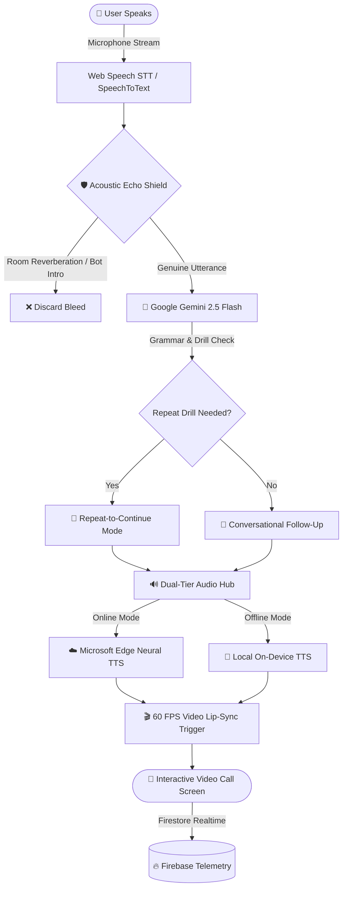

# 🎙️ SpeakFlow AI — Real-Time Hybrid AI Language & Accent Coach

[](https://firebase.google.com/)
[](https://aistudio.google.com/)
[](https://flutter.dev/)
[](https://nextjs.org/)
[](LICENSE)

> **SpeakFlow AI** is a next-generation real-time conversational AI language tutor built for Google's **#BuildHybridAI 2026** Hackathon. Combining on-device low-latency speech processing with ultra-realistic cloud Edge Neural speech synthesis, Google Gemini 2.5 Flash, and 60 FPS interactive video avatars, SpeakFlow AI gives language learners a real, low-anxiety phone call experience to master English, Japanese, and Korean.

---

## 🌟 Key Highlights & Innovations

### 1. ⚡ Dual-Tier Hybrid Audio Architecture
* **Tier 1 (Cloud Human-Quality)**: Streams ultra-realistic **Microsoft Edge Neural Studio TTS** (e.g. `en-GB-SoniaNeural`, `en-US-ChristopherNeural`, `ja-JP-NanamiNeural`) with verified pitch/gender accuracy.
* **Tier 2 (On-Device Zero-Latency)**: Automatic offline fallback to native device TTS hardware (`flutter_tts`) when offline simulation or in-flight mode is engaged.

### 2. 🛡️ 5-Layer Acoustic Echo Shield
* **Hardware Echo Suppression**: High-speed microphone buffer flushing (`speech.cancel()` and `speech.stop()`) when the coach starts speaking.
* **Temporal Acoustic Shield**: 1200ms decay window ensures room reverberation and laptop speaker bleeding never trigger false inputs.
* **Intelligent Utterance Parsing**: Distinguishes between concise natural answers (*"I like T20"*, *"Test matches"*, *"Yes"*) and coach identity bleed (*"I'm Coach Emma"*).

### 3. 🔁 Active Pronunciation Drill Engine
* Evaluates user pronunciation against target CEFR sentences using Google Gemini.
* Automatically locks into an interactive repeat-to-continue drill when mispronunciation or grammar slips are identified, unlocking upon successful mastery.

### 4. 🎭 60 FPS Interactive Video Coaches
* Seamless state machine toggling between idle ambient listening video loops and high-definition speaking video loops synchronized to audio playback.
* Coach personas with distinct pedagogical styles:
  * **Coach Emma** (British RP, Confident Cambridge Business English)
  * **Coach Alex** (American West Coast, Warm & Casual Conversational)
  * **Coach Aoi** (Japanese / Global, Gentle & Patient Bilingual Practice)

---

## 🏗️ Architecture Flow



---

## 📂 Repository Structure

```
speakflow-ai/
├── mobile-app/               # Flutter Multi-Platform App (Android, iOS, Web)
│   ├── lib/
│   │   ├── models/           # Topic, CoachPersona, Drill Models
│   │   ├── screens/          # LiveCallScreen, HomeScreen, DrillScreens
│   │   ├── services/         # GeminiVoiceService, WebSpeechBridge, AudioPlayer
│   │   └── web/              # Web Speech & Audio JS bridges
│   └── pubspec.yaml          # Flutter dependencies
│
├── web-app/                  # Next.js 15 Web Practice App
│   ├── src/
│   │   ├── app/              # App Router (Call Room, Topics, Auth)
│   │   │   └── api/tts/      # ⚡ Edge Neural TTS audio streaming endpoint
│   │   └── components/       # Video call viewport, transcript hud
│   └── package.json
│
├── admin-panel/              # Next.js 15 Admin & Analytics CMS
│   ├── src/
│   │   ├── app/              # Dashboard, Scenarios CMS, Gemini Config
│   │   └── lib/              # Firebase Admin & Firestore sync
│   └── package.json
│
├── .gitignore                # Enterprise-grade git ignore rules
└── README.md                 # Project documentation
```

---

## 🚀 Getting Started

### 📋 Prerequisites
* **Flutter SDK**: `>= 3.22.0`
* **Node.js**: `>= 18.18.0` (pnpm or npm)
* **Google Gemini API Key**: Free tier from [Google AI Studio](https://aistudio.google.com/app/apikey)
* **Firebase Project**: Firestore & Authentication enabled

---

### 1️⃣ Run the Flutter Mobile / Web App

```powershell
cd mobile-app
flutter pub get

# Run on Chrome Web (Port 8085)
flutter run -d web-server --web-port 8085 --web-hostname localhost

# Or run on connected Android Device
flutter run -d android
```

---

### 2️⃣ Run the Next.js Web App & Edge TTS Streamer

```powershell
cd web-app
npm install
npm run dev -- -p 3001
```
* The web practice room will run at `http://localhost:3001`
* Edge Neural TTS stream API active at `http://localhost:3001/api/tts`

---

### 3️⃣ Run the Admin Panel

```powershell
cd admin-panel
npm install
npm run dev -- -p 3000
```
* Access the telemetry and topic manager at `http://localhost:3000`

---

## 🔒 Security & Privacy
* **Zero Hardcoded Secrets**: All API tokens and credentials are encrypted or read from environment variables.
* **Isolated Cloud Footprint**: Uses isolated Firestore collections (`lang_topics`, `lang_users`, `lang_settings`, `lang_sessions`) ensuring zero collision with existing database documents.

---

## 🏆 Hackathon Submission Metadata
* **Track**: Google Firebase #BuildHybridAI 2026
* **Team**: InnoXpert Technologies / Janitha Dilshan (`@janiya2`)
* **Core Technologies**: Google Firebase, Google Gemini 2.5 Flash, Flutter Web/Mobile, Next.js 15, Edge Neural TTS.

---

## 📄 License
This project is licensed under the [MIT License](LICENSE).
